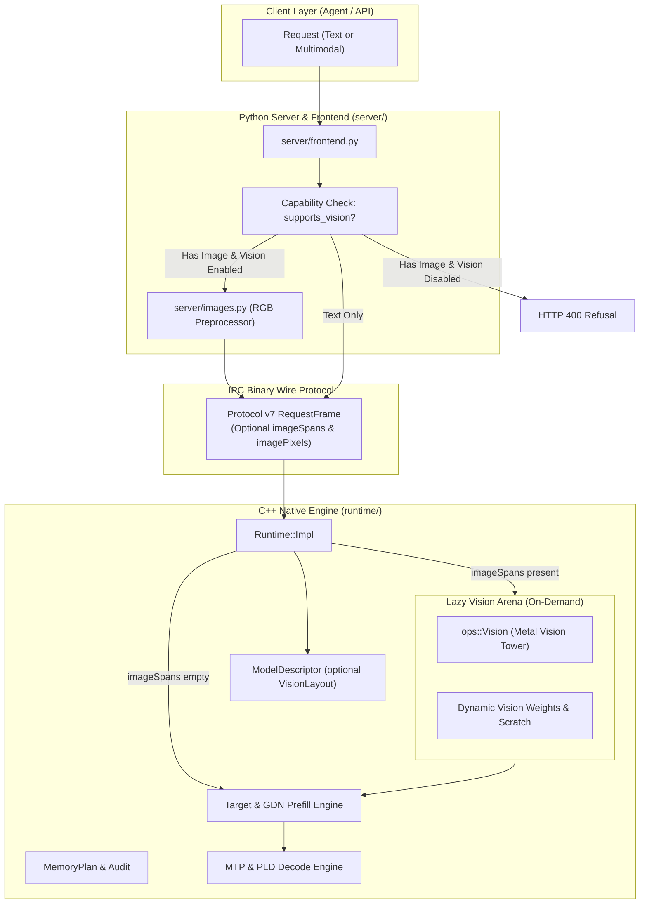
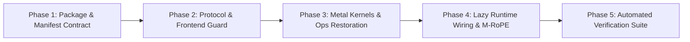

# Architecture & Implementation Plan: Optional & Lazy Vision Subsystem in Slipstream

**Document ID:** `PLAN-2026-10-19-VISION-OPTIONAL`  
**Status:** Proposed / Review  
**Target Architecture:** Qwen3.8-Flash-Next (`qwen4exp`) & Swift-Qwen3.8-27B on Apple Silicon (M5 Pro, 64 GB Unified Memory)  
**Historical Reference:** Reversion & conditional refactoring of Commit [`114d979a`](file:///Users/nitin/Documents/shared-with-google-drive/model-serving/slipstream) (*"Slipstream phase 2: text only - remove vision end to end"*)

---

## 1. Executive Summary & Goals

### 1.1 Objective
Design and implement an **optional, on-demand vision subsystem** for Slipstream that:
1. **Never imposes overhead on text-only tasks:** When processing text/code prompts (the primary daily workload for `omp`, `pi`, `claude`), the engine consumes **0 bytes** of unified memory for vision weights, allocates **no vision scratch buffers**, and adds **0 ns** to prefill/decode loops.
2. **Eliminates dead placeholder artifacts:** Text-only model packages no longer carry a dummy 906 MB `vision/model.bin` placeholder file on SSD.
3. **Supports native multimodal execution when needed:** If a package provides valid vision weights (or a user specifies a multimodal checkpoint), the engine dynamically or conditionally loads the vision encoder, converts image inputs into embedding tokens via Metal kernels, and injects them seamlessly into the transformer residual stream.

### 1.2 Core Architectural Principles
* **Pay-Only-For-What-You-Use:** Pure text inference must perform identically (in throughput, TTFT, and resident footprint) to the current text-only engine.
* **Strict Memory Safety (<4.5 GiB Floor):** On 64 GB Macs, Flash-Next with 32 GiB expert cache and long-context KV caches operates near the OS memory ceiling. Vision weights and scratch buffers must never push free memory below the 4.0 GiB watchdog threshold.
* **Format & Protocol Decoupling:** The binary IPC wire format and manifest schema must distinguish between text-only and multimodal configurations without fragile hardcoded expectations.

---

## 2. End-to-End Architecture



---

## 3. Detailed Component Plan

### 3.1 Model Package Specification & Converter

#### A. Manifest Schema (`manifest.json`)
The `"vision"` block becomes strictly optional. When present, it specifies the architectural parameters for `QwenVision`:

```json
{
  "model": "Qwen3.8-Flash-Next",
  "schema_version": 6,
  "format": {
    "name": "splash-packed-q4-qwen4exp",
    "vision_magic": "MDFV0001"
  },
  "vision": {
    "architecture": "QwenVision",
    "depth": 27,
    "hidden_size": 1152,
    "intermediate_size": 4304,
    "num_heads": 16,
    "patch_size": 16,
    "spatial_merge_size": 2,
    "temporal_patch_size": 2,
    "out_hidden_size": 2560
  }
}
```

* **Text-only packages:** Omit `"vision"` entirely. The file [`vision/model.bin`](file:///Users/nitin/models/swift-qwen38-flash-next-v3/prepared/vision/model.bin) is omitted from disk, saving ~906 MB SSD storage.
* **Multimodal packages:** Include `"vision"`. The converter extracts and quantizes/packs the vision tower from source checkpoints into `vision/model.bin`.

#### B. Converter Updates ([`convert_qwen4exp.py`](file:///Users/nitin/Documents/shared-with-google-drive/model-serving/slipstream/models/qwen4exp/tools/convert_qwen4exp.py))
* Add `--vision {extract,placeholder,none}` flag (default: `none` or `auto`).
* If `extract`: Reads real vision weights from safetensors/GGUF (`visual.*` or `v.*`) using the verified 27-layer layout.
* If `none`: Completely skips `write_placeholder_vision` and does not write `"vision"` to `manifest.json`.

---

### 3.2 Native C++ & Metal Engine (`runtime/`)

#### A. Model Descriptor & Package Validation ([`ModelDescriptor.hpp`](file:///Users/nitin/Documents/shared-with-google-drive/model-serving/slipstream/runtime/model/ModelDescriptor.hpp) & [`.mm`](file:///Users/nitin/Documents/shared-with-google-drive/model-serving/slipstream/runtime/model/ModelDescriptor.mm))
1. In `ModelDescriptor`:
   ```cpp
   struct ModelDescriptor final {
     std::string name;
     TargetLayout target;
     DFlashDraftLayout draft;
     std::optional<ops::VisionLayout> vision; // nullopt for text-only
     bool supportsVision() const noexcept { return vision.has_value(); }
     ...
   };
   ```
2. In `inspectModelPackage()`:
   * Inspect `manifest.json`. If key `"vision"` is present:
     * Parse and validate vision layout against `MDFV0001` format.
     * Validate `vision/model.bin` exists, has valid magic, and matches section offsets.
   * If `"vision"` is absent:
     * Set `descriptor.vision = std::nullopt;`.
     * Never attempt to open or stat `vision/model.bin`.

#### B. Conditional & Lazy Memory Allocation ([`MemoryPlan.cpp`](file:///Users/nitin/Documents/shared-with-google-drive/model-serving/slipstream/runtime/engine/MemoryPlan.cpp))
* **Resident Weights:** When `!descriptor.supportsVision()`, resident vision weight bytes = 0.
* **Dynamic Scratch Arena:** The vision activation scratch buffer (~200–450 MB depending on max patch count) is **not** allocated at boot.
* **Lazy Initialization:**
  * In `Runtime::Impl`, hold vision as:
    ```cpp
    std::unique_ptr<ops::Vision> visionEngine;
    ```
  * Only on admission of the first request containing `!request.imageSpans.empty()`:
    ```cpp
    if (!impl_->visionEngine) {
        // Enforce memory guard check: ensure free RAM > 4.5 GiB before allocating
        uint64_t freeBytes = hostFreeMemoryBytes();
        if (freeBytes < kMinimumVisionAdmissionHeadroomBytes) {
            return StateAdmission::Failure("Insufficient host memory to load vision tower");
        }
        impl_->visionEngine = std::make_unique<ops::Vision>(backend, packagePath / "vision", *descriptor.vision);
    }
    ```

#### C. Metal Kernels & Vision Operators ([`runtime/ops/Vision.mm`](file:///Users/nitin/Documents/shared-with-google-drive/model-serving/slipstream/runtime/ops) & [`runtime/metal/kernels/shared/vision.metal`](file:///Users/nitin/Documents/shared-with-google-drive/model-serving/slipstream/runtime/metal))
* Re-import the verified vision kernels from commit `114d979a^`:
  * `vision_patch_embed`: Convolves 16x16 input patches with 3 in-channels to 1152 hidden dimensions.
  * `vision_layer`: 27 transformer layers (pre-norm, multi-head self-attention with 2D spatial rotary/learned positions, MLP).
  * `vision_patch_merger`: 2x2 spatial patch pooling + linear projection into model residual dimension (2560 for Flash-Next, 5120 for 27B).
* Lifecycle: Buffers used for raw pixels and intermediate patch states are freed immediately upon embedding generation.

#### D. Position Embeddings (M-RoPE) & Image Token Injection
* Flash-Next uses M-RoPE (multimodal rotary position embeddings) for interleaved text/images.
* In `Runtime.mm`:
  * Compute 3D position IDs `(temporal, height, width)` for visual tokens and maintain linear progression for text tokens.
  * Inject the `[merged_patches, 2560]` vision embeddings into `buffers.hidden[0]` at the placeholder token offsets prior to prefill wave 0.

#### E. Prefix Cache Digest Integration ([`KvCache.cpp`](file:///Users/nitin/Documents/shared-with-google-drive/model-serving/slipstream/runtime/engine/KvCache.cpp))
* Image placeholder token IDs (`<|image_pad|>`, `248056`) are identical across different images.
* In `KvCache::keyForPrefix()`:
  * For text-only spans: Hash token IDs directly.
  * For spans intersecting an image: Incorporate the 128-bit BLAKE3/SHA-256 hash of the image pixel content (`ImageSpanFrame::digest`) into the cache key.
  * This guarantees that two different images with identical prompt preambles do not suffer cache collisions.

---

### 3.3 IPC Binary Protocol ([`runtime/engine/Protocol.hpp`](file:///Users/nitin/Documents/shared-with-google-drive/model-serving/slipstream/runtime/engine/Protocol.hpp) & [`server/protocol.py`](file:///Users/nitin/Documents/shared-with-google-drive/model-serving/slipstream/server/protocol.py))

* Introduce **Protocol Version 7**:
  * Request header retains compact structure.
  * Add `uint32_t imageSpanCount = 0;` and `uint64_t imagePixelBytes = 0;`.
  * If `imageSpanCount == 0`, zero additional bytes are read from the IPC socket. Text requests incur 0 deserialization overhead.
  * If `imageSpanCount > 0`, deserializes `std::vector<ImageSpanFrame>` and pixel byte array.

---

### 3.4 Python Server & API Layer ([`server/`](file:///Users/nitin/Documents/shared-with-google-drive/model-serving/slipstream/server))

1. **CLI Flag (`server/server.py`):**
   * `--vision {auto,on,off}` (default `auto`).
   * When `off`, the server overrides model metadata to report text-only, even if vision weights are present.
2. **Input Processing ([`server/images.py`](file:///Users/nitin/Documents/shared-with-google-drive/model-serving/slipstream/server/images.py)):**
   * Re-enable image decoding (Pillow / libjpeg-turbo):
     * Resize images according to Qwen dynamic aspect ratio (multiples of 16x16 patch size, min 4 patches, max 1280 patches).
     * Output RGB byte buffers and patch grid dimensions.
3. **OpenAI / Anthropic Protocol Translation ([`server/frontend.py`](file:///Users/nitin/Documents/shared-with-google-drive/model-serving/slipstream/server/frontend.py)):**
   * Support OpenAI `image_url` and Anthropic `type: "image"` blocks.
   * If `supports_vision` is false, immediately reject with:
     ```python
     raise BadRequest("image input is not supported by this model instance")
     ```
   * If true, render prompt with `<|vision_start|>...<|vision_end|>` placeholder tokens and attach image frames.
4. **Agent Discovery (`/v1/models`):**
   * Dynamically report `"supports_vision": true/false` and `"input": ["text"]` or `["text", "image"]`.

---

## 4. Rigorous Self-Reflection & Stress-Testing

To ensure this plan is robust and prevents catastrophic failures, we subject the proposal to rigorous self-interrogation against historical project failure modes:

### Probe 1: Does lazy loading vision risk kernel panic or OOM on 64 GB Mac?
* **Failure Mechanism:** In `.agents/memory.md`, Mac kernel watchdogs panicking occurred when wired memory exceeded ~58 GiB or free RAM dipped below 4 GiB. Flash-Next with a 32 GiB expert cache, 7 GiB base weights, and 12 GiB KV cache leaves only ~4–5 GiB free headroom.
* **Stress Test:** What happens if an agent submits a 64k token prompt containing 4 high-resolution images?
* **Mitigation Built Into Plan:**
  1. **Strict Admission Guard:** The engine checks `hostFreeMemoryBytes()` before loading vision weights. If free memory < 4.5 GiB, the request fails gracefully with HTTP 503 (`resource_exhausted`) instead of crashing the OS.
  2. **Expert Cache Auto-Trim:** When vision is active, optionally clamp `SPLASH_EXPERT_CACHE_GIB` to 30 GiB (saving 2.4 GiB host RAM) as proven in `.agents/decisions.md` line 380.
  3. **Immediate Scratch Reclamation:** Vision activation scratch buffers are allocated via a temporary Metal heap and released immediately after visual token prefill finishes, before KV decode begins.

### Probe 2: Does restoring vision degrade text decode throughput?
* **Failure Mechanism:** Any extra checks, branching, or tensor copies in `Runtime::decodeTick` or `Qwen4ExpTarget` directly degrade token-generation rate.
* **Stress Test:** Run the 10-prompt speed suite (`speed_suite.py`) with vision enabled but idle.
* **Mitigation Built Into Plan:**
  * Vision operations terminate completely at prefill stage 0.
  * In the decode tick, `request.imageSpans` is not inspected. The decode loop touches only text KV tokens, MTP draft heads, and routed MoE experts.
  * Verified invariant: **0 GPU dispatches and 0 nanoseconds added to decode.**

### Probe 3: What prevents cache poisoning in multi-turn agent sessions?
* **Failure Mechanism:** If an agent runs a multi-turn session where Turn 1 includes an image and Turn 2 includes only text, does the KV cache retain the visual context without leaking or corrupting positions?
* **Stress Test:** Test prefix cache reuse with interleaved text and image turns.
* **Mitigation Built Into Plan:**
  * Image tokens are written into the exact same KV page tables (`PagedAttention`) as text tokens during prefill.
  * Once visual tokens are committed to the KV cache, the attention verifier treats them as standard key-value blocks.
  * Prefix cache keys incorporate the BLAKE3 digest of the image, ensuring Turn 2 cleanly hits the cached prefix.

### Probe 4: How is speculative drafting (MTP & PLD) affected?
* **Failure Mechanism:** Prompt Lookup Decoding (PLD) or MTP might attempt to match or predict raw image tokens (`<|image_pad|>`), triggering false-positive matches and stalling the MoE verifier.
* **Stress Test:** Inspect speculative draft proposals on prompts with leading images.
* **Mitigation Built Into Plan:**
  * Prompt Lookup Decoding (`ops::PromptLookup`) is explicitly restricted to tokens where `token_id != kImagePadTokenId`.
  * MTP draft head vocabulary ignores image placeholder tokens.

---

## 5. Phased Execution Roadmap



| Phase | Tasks | Verification Gate |
|---|---|---|
| **Phase 1: Manifest & Package Contract** | 1. Update `ModelDescriptor.mm` to make `"vision"` optional.<br>2. Update `convert_qwen4exp.py` with `--vision none`.<br>3. Verify text-only packages load without `vision/model.bin`. | `make test-engine-cpu`<br>Load `local/prepared` without dummy vision file. |
| **Phase 2: Protocol & Frontend Negotiation** | 1. Implement Protocol v7 with optional image spans.<br>2. Add `--vision {auto,on,off}` to `server.py`.<br>3. Add capability gating in `frontend.py`. | `test_protocol_python.py`<br>`test_http_boundaries.py` |
| **Phase 3: Metal Vision Restoration** | 1. Reinstate `vision.metal` and `ops/Vision.mm`.<br>2. Wire 27-layer forward pass with dynamic scratch heap. | `make test-engine-metal`<br>`vision_encoder_test.mm` standalone test. |
| **Phase 4: Lazy Runtime Wiring & M-RoPE** | 1. Add lazy allocation in `Runtime.mm`.<br>2. Wire visual embedding injection into prefill.<br>3. Implement M-RoPE position offsets. | Image end-to-end forward test against reference logits. |
| **Phase 5: Verification & Benchmark Suite** | 1. Multi-turn text/image session tests.<br>2. Memory guard stress test (<4.5 GiB threshold).<br>3. 10-prompt speed suite regression verification. | Decode throughput unchanged (>= 51.9 tok/s greedy). |
